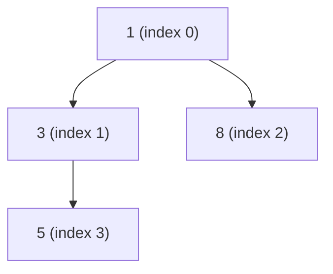

# Heap

A heap is a collection that always knows its best element. Ask a min heap
for its smallest element, or a max heap for its largest, and the answer is
waiting at the top; remove it and the next best takes its place in
logarithmic time. It is the structure behind a **priority queue**: a queue
where the order of departure is set by a priority rather than by arrival.
An operating system's scheduler picking the next task, Dijkstra's algorithm
picking the next closest vertex, a discrete-event simulation picking the
next event, and "find the k largest of these n" are all heaps.

The guide's implementation is
[`Heap`][cs_survival_kit.data_structures.heap.Heap], with
[`MinHeap`][cs_survival_kit.data_structures.heap.MinHeap] and
[`MaxHeap`][cs_survival_kit.data_structures.heap.MaxHeap] as named versions
of its two directions. Like the [stack](stack.md) and the [queue](queue.md)
it is built over one of the guide's lists, a [dynamic array](dynamic-array.md),
and it hides everything but its own operations. Unlike them, it does real
work on every change: a stack or queue moves one element at one end, while
a heap moves an element up or down a tree. The point of this page is why
that work is only logarithmic, why building the whole thing is only linear,
and why a tree can live in an array at all.

## How it works

A binary heap is a **complete binary tree**: every level is full except
possibly the last, which fills from the left. Each node outranks its
children, so the root outranks everything. That is the entire invariant.
It says nothing about the order of siblings or cousins, which is why the
tree is not sorted and why it is cheap to maintain.



Because the tree is complete, reading it level by level from the top, left
to right, packs the nodes into an array with no gaps. The tree above is
the array `[1, 3, 8, 5]`, and the tree is never built: it is computed from
positions.

| Index | 0 | 1 | 2 | 3 |
| --- | --- | --- | --- | --- |
| Element | 1 | 3 | 8 | 5 |
| Parent at | | 0 | 0 | 1 |
| Children at | 1, 2 | 3, 4 | 5, 6 | 7, 8 |

For the node at index $i$, the children are at $2i + 1$ and $2i + 2$ and
the parent is at $\lfloor (i - 1) / 2 \rfloor$. There are no node objects
and no links to follow, only arithmetic on indices, which is why the heap
sits on a `List` rather than on one of the linked lists. Each slot holds an
element together with the key it is ranked by (more on that
[below](#min-or-max-one-comparison)).

Every heap operation is a list operation at the end of the array plus a
walk up or down one path of the tree:

| Heap operation | What happens | In the library |
| --- | --- | --- |
| Push | append at the end, then sift up | [`push`][cs_survival_kit.data_structures.heap.Heap.push] |
| Pop | swap the root with the last element, remove the last, then sift the new root down | [`pop`][cs_survival_kit.data_structures.heap.Heap.pop] |
| Peek | read index 0 | [`peek`][cs_survival_kit.data_structures.heap.Heap.peek] |

The appends and removals happen at the array's cheap end, where nothing
shifts. The sifts are where the logarithm comes from.

## Why logarithmic: the height of a complete tree

A complete binary tree with levels $0$ to $h$ has at most
$1 + 2 + 4 + \dots + 2^h = 2^{h+1} - 1$ nodes, a
[geometric series](../math/cheat-sheet.md#geometric-series), and at least
$2^h$, because the last level has at least one node. So a tree of $n$ nodes
has

$$
2^h \le n < 2^{h+1}
\qquad \text{so} \qquad
h = \lfloor \log_2 n \rfloor
$$

A sift moves an element one level per step, up towards the root or down
towards the leaves, and stops as soon as the invariant holds. It can never
take more steps than there are levels, so every sift is $O(\log n)$. A
million elements is a tree of height 19.

## Pushing: sift up

A new element goes at the end of the array, which is the next free slot in
level order, so the tree stays complete. It is then compared with its
parent: if it outranks the parent, the two swap, and the comparison repeats
one level up. The sift stops at the first parent that outranks the new
element, or at the root.

Pushing 2 onto `[1, 3, 8, 5]`:

```text
[1, 3, 8, 5, 2]   appended at index 4; parent is index 1 (3)
[1, 2, 8, 5, 3]   2 outranks 3, swap; parent is now index 0 (1)
                  1 outranks 2, stop
```

Why is the invariant whole again? The only pairs that changed are on the
path the element climbed. At each swap the climbing element outranked the
parent it replaced, so it also outranks the parent's other child, which the
old parent already outranked. Everything off the path is untouched.

## Popping: sift down

The root is the element to return, but removing index 0 from an array
would shift everything, and removing it from the tree would leave a hole at
the top. So the root is swapped with the *last* element, the last slot is
removed (the array's cheap end, and the tree stays complete), and the
element now at the root is sifted down: compare it with its children, and
if either outranks it, swap it with the *better* of the two and repeat from
there.

Popping from `[1, 3, 8, 5]`:

```text
[5, 3, 8]   1 returned; 5 moved from the end to the root
[3, 5, 8]   children are 3 and 8; 3 is the better, and outranks 5, swap
            index 1 has no children, stop
```

Swapping with the better child is what keeps the invariant. That child
outranks both its sibling and the element coming down, so it is fit to be
the parent of both. Swapping with the worse child would put it above the
better one, and the invariant would break one level down. This is also the
one place in the code where a heap is easy to get wrong: the comparison on
each step has to be against the best candidate found so far, not against
the element that started the sift.

## Building a heap in linear time

Given $n$ elements at once, pushing them one at a time costs
$O(n \log n)$ in the worst case. Doing better rests on one observation:
in a complete tree, most nodes are near the bottom, and a node near the
bottom has almost nowhere to sift down to.

**Heapify** places all $n$ elements in the array as they come, then walks
the nodes that have children, from the last of them back to the root,
sifting each one down. Half the nodes are leaves and need nothing. A
quarter are one level up and sift at most one step. An eighth sift at most
two. At height $h$ there are at most $\lceil n / 2^{h+1} \rceil$ nodes, each
sifting at most $h$ steps, so the total is bounded by

$$
\sum_{h=0}^{\lfloor \log_2 n \rfloor} h \cdot \frac{n}{2^{h+1}}
= \frac{n}{2} \sum_{h=0}^{\infty} \frac{h}{2^h}
= \frac{n}{2} \cdot 2
= n
$$

using the
[weighted geometric series](../math/cheat-sheet.md#weighted-geometric-series).
The few nodes that sift a long way are outnumbered by the many that barely
move, and the sum is linear. The library's constructor does exactly this,
which is why `Heap(items)` is $O(n)$ while $n$ calls to `push` are
$O(n \log n)$.

Heapifying `[5, 3, 8, 1]`:

```text
[5, 3, 8, 1]   start at index 1 (3): child is 1, which outranks it
[5, 1, 8, 3]   swap; index 3 has no children
               index 0 (5): children 1 and 8; 1 is the better, swap
[1, 5, 8, 3]   continue at index 1 (5): child is 3, which outranks it
[1, 3, 8, 5]   swap; done
```

??? note "Why not sift up instead?"

    Walking the array forwards and sifting each element *up* also builds a
    valid heap, and looks just as simple. But it is the mirror image of the
    wrong sum: a node at *depth* $d$ sifts up at most $d$ steps, and most
    nodes are deep, so the total is $\sum d \cdot 2^d$ over the depths,
    which is $\Theta(n \log n)$. Sifting down puts the long walks on the
    few nodes near the top; sifting up puts them on the many nodes near
    the bottom. Same tree, same operations, opposite result.

## Min or max? One comparison

A min heap and a max heap are the same structure. Every sift asks a single
question, "does this element outrank that one?", and the two heaps answer
it with the same `<` and the operands the other way round. So the library
has one `Heap` whose `reverse` argument flips that comparison, exactly as
it does for `sorted`, and `MinHeap` and `MaxHeap` are the two settings
with names. The benchmarks below show their lines lying on top of each
other.

The library also takes a `key`, again as `sorted` does, so that a heap can
rank records by one field: tasks by deadline, vertices by distance, events
by time. Two decisions make that work:

- **The key is computed once, when the element enters,** and stored beside
  it. Nothing is recomputed on the way up or down, and the key function is
  called exactly once per element however long the element stays.
- **Only keys are ever compared.** Never the elements, never the stored
  pairs. Two records with equal keys are never compared with each other,
  so the records do not need to support `<` at all.

The second point is the one `heapq` users meet the hard way. The standard
library's heap compares elements directly, so the idiom for a priority is a
`(priority, item)` tuple, and tuples compare element by element. The moment
two priorities tie, Python compares the items, and if they are dicts or
objects without an ordering, the push raises. A `key` sidesteps the whole
problem.

The cost of a stored key is that it is frozen. If an element's priority
changes while it sits in the heap, the heap does not know and the
invariant may silently fail. Changing a priority in place is
**decrease-key**, which needs a map from each element to its position so
that the sift can start there, and it is a different structure (an
*indexed* heap). Elements with equal keys come out of `pop` in no
particular order, as they do from `heapq`.

## Storage order

Like the [stack](stack.md#two-orders), the heap has to decide what
iteration means. It yields the elements in **storage order**, which is the
tree read level by level: the root first, then its children, then theirs.
That is not priority order beyond the first element and it is not sorted,
but it costs $O(n)$ with nothing copied, it is the order the diagrams on
this page draw, and `sorted(h)` is always there for the other reading.

`repr` prints the same order, so `Heap([1, 3, 8, 5])` is the array as
stored. For a heap that ranks its elements by themselves it reads back as
the constructor call that rebuilds the identical layout, because
heapifying an array that already satisfies the invariant moves nothing.
`MaxHeap([8, 3, 5, 1])` round-trips the same way. A heap built with a
custom `key` cannot, because a function has no literal.

## Which heap?

| | Push and pop | Best element | Also offers | Reach for it when |
| --- | --- | --- | --- | --- |
| `Heap` (this guide) | O(log n) | O(1) | `key`, `reverse`, named min and max types | the code should only ever see a priority queue, or ranks records |
| `heapq` | O(log n) | O(1) | `heapify`, `nlargest`, `nsmallest`, `merge`, all in C | almost always, in ordinary single-threaded code with comparable elements |
| `queue.PriorityQueue` | O(log n) | O(1) | locking, blocking `get` | producers and consumers are on different threads |
| sorted `list` with `bisect.insort` | O(n) to insert, O(1) to pop the end | O(1) | everything a list offers, in order | the collection is small or rarely changes |

`heapq` is the standard library's heap and the right default in Python. It
is a set of functions over a plain `list`, min only, and it compares the
elements themselves. The guide's `Heap` exists to show what is underneath
those functions, and the sorted list appears in the benchmarks below as
the structure a heap replaces: it answers "which is best?" just as fast,
but pays $O(n)$ to accept each new element.

## Measured

The benchmarks below time the library's `Heap` against `heapq` (the same
algorithm in C over a built-in `list`) and against a sorted list kept with
`bisect.insort`. The inputs are deliberately worst cases: descending
integers pushed onto a min heap, so that every new element is the smallest
so far and climbs all the way to the root, and ascending integers onto a
max heap, which is the mirror image. On random input a push averages a
constant number of swaps, a fine property to know but one that hides the
shape being measured. All chart axes are logarithmic.

### Pushing

Each run pushes n integers onto an empty heap, or inserts them into an
empty sorted list. The first tab divides by n to give the cost of one
push.

{{ benchmark("heap.push") }}

The two heap lines rise gently and lie on top of each other: a min heap
and a max heap are the same code, and each push climbs $\log_2 n$ levels,
so the per-push cost grows by a constant every time n grows by a factor
of two. On the total-time tab that is a line of slope just over 1.
`heapq` has the same shape, far lower, because its sifts run in C. The
sorted list is the odd one out: `bisect` finds the slot in $O(\log n)$ but
inserting at the front shifts everything behind it, so the per-insert
line rises in step with n and the total has slope 2.

### Popping

Each run empties a heap of n elements, best first, or pops a sorted list
of n elements from its end.

{{ benchmark("heap.pop") }}

The heap lines have the same gentle rise as for push, since each pop sends
the last element to the root and sifts it back down, nearly always to the
bottom. Popping the end of a sorted list is flat: that is the sorted
list's one cheap operation, and the reason it is a fair comparison. A
sorted list is a fine priority queue to drain and a poor one to fill; a
heap is cheap at both.

### Building

Each run builds a heap of n elements, either by heapifying them in one go
or by pushing them one at a time. The per-item tab is the chart to read.

{{ benchmark("heap.heapify") }}

Heapify is flat per item: the cost of placing one element does not depend
on how many others there are, which is the linear bound in action. Pushing
one at a time rises with $\log_2 n$, the same line as the push benchmark.
The gap between the two opens slowly, because $\log_2 n$ grows slowly,
but it is there at every size and it is the whole difference between
$O(n)$ and $O(n \log n)$. The two `heapq` lines show the same pair of
shapes at C speed.

### Peeking

Here n is the size of the heap, and every run performs the same thousand
reads of the root. The time is not divided by n: a flat line means reading
the best element costs the same at any size.

{{ benchmark("heap.peek") }}

Both lines are flat. The root is index 0 of an array, and nothing about
reading it depends on what is below.

## Complexity

| Operation | Time | Notes |
| --- | --- | --- |
| Push | O(log n) | plus the array's O(1) amortized append; one call to `key` |
| Pop | O(log n) | the array's removal is from the end, so nothing shifts |
| Peek | O(1) | |
| Build from n items | O(n) | heapify, not n pushes |
| Length | O(1) | from the list's size count |
| Iterate | O(n) | storage order, not priority order |
| Search for a value | O(n) | via iteration |

These agree with the `Complexity:` table in
[`Heap`][cs_survival_kit.data_structures.heap.Heap]. The logarithms are the
height of a complete binary tree. Only `push` carries an amortized term,
and it is the dynamic array's, not the heap's: a push that finds the array
full triggers a resize, spread over the pushes before it exactly as for
the stack. Total storage is one element and one key per slot plus the
array's spare capacity, $O(n)$.
