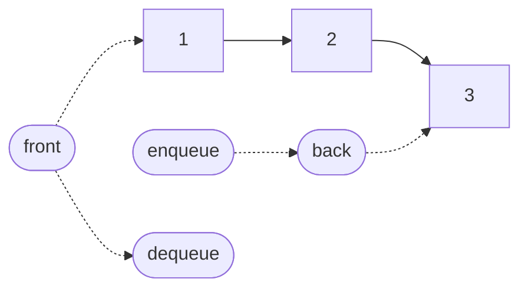

# Queue

A queue is a collection with one rule: the first element in is the first
element out. Elements are **enqueued** at the back and **dequeued** from the
front, so the element that has waited longest is always the next to leave.
A print queue, a breadth-first search, a task scheduler and a message broker
are all queues. Anything that must be handled in the order it arrived is a
queue.

The guide's implementation is
[`Queue`][cs_survival_kit.data_structures.queue.Queue]. Like the
[stack](stack.md), it is a thin layer over one of the guide's lists with
everything but the queue operations hidden. The difference is *which* list,
and that difference is the point of this page. A queue works at both ends
of its sequence, and the two ends of a [dynamic array](dynamic-array.md) do
not cost the same, so the queue sits on a
[singly linked list](singly-linked-list.md) instead.

## How it works

The queue holds a
[`SinglyLinkedList`][cs_survival_kit.data_structures.singly_linked_list.SinglyLinkedList]
and uses its two ends as the **back** and the **front**. The list's head is
the front and its tail is the back. Every queue operation is one list
operation at one of those ends:

| Queue operation | List operation underneath | In the library |
| --- | --- | --- |
| Enqueue | append at the end | [`enqueue`][cs_survival_kit.data_structures.queue.Queue.enqueue] |
| Dequeue | remove from the front | [`dequeue`][cs_survival_kit.data_structures.queue.Queue.dequeue] |
| Peek | read the first element | [`peek`][cs_survival_kit.data_structures.queue.Queue.peek] |

On a singly linked list all three are O(1). Appending uses the tail
reference and sets two links. Removing from the front moves the head one
node along. Reading the front is reading the head. Nothing ever touches the
middle of the list, so nothing ever walks it, and that is what keeps every
operation constant time.

## Why not the array?

The stack sits on the guide's default list, a dynamic array, and gets O(1)
operations because it only ever touches the array's end. A queue cannot do
that. It adds at one end and removes at the other, and on an array one of
those ends is expensive.

Appending at the end of an array is cheap. Removing from the *front* is not:
every remaining element has to shift one slot toward the front to keep the
block contiguous, so a single removal is O(n). Draining a queue of $n$
elements that way shifts $n - 1$ elements, then $n - 2$, and so on down to
none, which is the
[arithmetic series](../math/cheat-sheet.md#arithmetic-series):

$$
\sum_{i=1}^{n-1} i = \frac{n(n-1)}{2} = \Theta(n^2)
$$

A queue that spends quadratic time emptying itself is not a queue anyone
would use. The linked list removes the problem at its source: unlinking the
head node costs the same whether one node follows it or a million.

??? note "The array's answer: a ring buffer"

    Arrays can make a good queue, but not by shifting. A **ring buffer**
    keeps a *front index* as well as a length, so dequeuing moves the index
    forward instead of moving the elements, and enqueuing wraps around to
    reuse the slots that were freed. That is how Java's `ArrayDeque` works,
    and Python's `collections.deque` does something similar with a linked
    list of 64-slot blocks. The guide's queue uses the linked list because
    it already has one with an O(1) front, and because the comparison with
    the array is the lesson; a ring buffer would be a good structure to
    add later.

## One order

Where the [stack](stack.md#two-orders) has to choose between two readings,
the queue does not. Iteration runs from the front to the back, which is
the order `dequeue` would return the elements. Because a queue releases
elements in the order they arrived, that is also the order they were
enqueued, so `repr` prints the same sequence: `Queue([1, 2, 3])` has 1 at
the front, `list(q)` is `[1, 2, 3]`, and `eval(repr(q))` rebuilds the
same queue. A queue is the structure where "what comes out next" and "how
was this built" are the same question.

## Stack or queue?

| | Stack | Queue |
| --- | --- | --- |
| Rule | last in, first out | first in, first out |
| Ends touched | one | both |
| Underneath, in this guide | dynamic array | singly linked list |
| Enqueue or push | O(1) amortized | O(1) |
| Dequeue or pop | O(1) | O(1) |
| Memory | one contiguous block, capacity up to $2n$ | one node and one link per element |
| Reach for it when | the most recent thing matters: undo, recursion, matching brackets | arrival order matters: scheduling, buffering, breadth-first search |

The two are the simplest examples of a design rule that recurs throughout
this guide: decide which operations a structure must make cheap, then pick
the storage whose cheap end matches. The stack needed one end and took the
array. The queue needed both and took the linked list.

## Which queue?

| | Enqueue and dequeue | Also offers | Reach for it when |
| --- | --- | --- | --- |
| `Queue` (this guide) | O(1) | nothing | the code should only ever see a queue |
| `collections.deque` | O(1) | the same at the other end, a maximum length, rotation | almost always, in ordinary single-threaded code |
| `queue.Queue` | O(1) | locking, blocking `get`, `task_done` | producers and consumers are on different threads |
| `list` with `pop(0)` | O(n) to dequeue | everything a list offers | never, for a queue of any size |

`collections.deque` is the standard library's queue and the right default in
Python. The guide's `Queue` exists to show what is underneath that choice,
and `list.pop(0)` appears in the benchmarks below to show what happens
without it.

## Measured

The benchmarks below time the library's `Queue` against the
`SinglyLinkedList` underneath it, its `DynamicArray`, Python's built-in
`list` (a dynamic array written in C) and `collections.deque` (a linked
list of blocks, also in C). All chart axes are logarithmic.

### Enqueuing

Each run enqueues n integers onto an empty queue. The first tab divides by
n to give the cost of one enqueue.

{{ benchmark("queue.enqueue") }}

All four lines are flat: adding at the back is O(1) for every container
here. `Queue` and `SinglyLinkedList` run together, separated by the one
method call the adapter adds. Both sit well above the two C structures, and
that gap is the cost of allocating a Python node per element. It is a
constant, so the lines are parallel.

### Dequeuing

Each run empties a queue of n elements from the front. This is the chart
the page is about.

{{ benchmark("queue.dequeue") }}

`Queue` and `deque` are flat: unlinking the front node costs the same at
any size. The two arrays climb in step with n, because every removal shifts
everything behind it. On the total-time tab that is two lines of slope 1
against two of slope 2, and it is why the array cases are measured at far
smaller sizes than the others.

Note the order of the two array lines. The built-in `list` shifts its
elements with a single C memory move, so at the sizes shown it still
finishes quickly. The library's `DynamicArray` shifts them one at a time in
Python, and the quadratic cost arrives much sooner. The slope is the same;
only the constant differs. Complexity says what happens as n grows, and the
built-in list would reach the same place at a larger n.

### Peeking

Here n is the length of the queue, and every run performs the same thousand
reads of the front element. The time is not divided by n: a flat line means
reading the front costs the same at any length.

{{ benchmark("queue.peek") }}

Every line is flat. The front of a linked list is its head node and the
front of an array is index 0; neither depends on how much is behind it.

## Complexity

| Operation | Time | Notes |
| --- | --- | --- |
| Enqueue | O(1) | one node allocated, no resize |
| Dequeue | O(1) | |
| Peek | O(1) | |
| Length | O(1) | from the list's size count |
| Iterate | O(n) | from the front to the back |
| Search for a value | O(n) | via iteration |

These agree with the `Complexity:` table in
[`Queue`][cs_survival_kit.data_structures.queue.Queue], and they are the
singly linked list's costs at its two ends. None is amortized, because a
linked list never resizes. Total storage is one node per element and
shrinks as elements leave; over a dynamic array, dequeue would be O(n) and
draining the queue $O(n^2)$.
