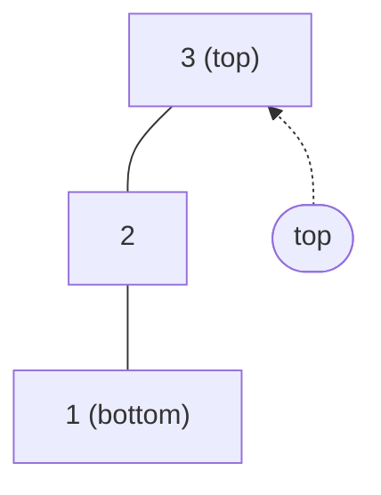

# Stack

A stack is a collection with one rule: the last element in is the first
element out. Elements are **pushed** onto the top and **popped** off the
top, and nothing else is touched. The undo history in an editor, the back
button in a browser, the call stack that tracks which function is running
and the bracket matcher in a compiler are all stacks.

The guide's implementation is
[`Stack`][cs_survival_kit.data_structures.stack.Stack]. It is not a list
with extra operations; it is a layer over the guide's default
[dynamic array](dynamic-array.md) with most of the list's operations taken
away. This page is about why that is the right shape, and what it costs.
The [queue](queue.md) is the same idea with the opposite rule, and the two
pages are meant to be read together.

## How it works

The stack holds a
[`List`][cs_survival_kit.data_structures.default_list.List] and uses its
**end** as the top. Every stack operation is one list operation at that
end:

| Stack operation | List operation underneath | In the library |
| --- | --- | --- |
| Push | append at the end | [`push`][cs_survival_kit.data_structures.stack.Stack.push] |
| Pop | remove from the end | [`pop`][cs_survival_kit.data_structures.stack.Stack.pop] |
| Peek | read the last element | [`peek`][cs_survival_kit.data_structures.stack.Stack.peek] |

The end is the cheap end of a dynamic array. Appending writes into the next
free slot, removing from the end releases the last slot, and reading the
last element is one index calculation. Nothing shifts, because nothing is
ever behind the position being touched. The stack inherits the array's
costs at that end and adds one method call.

## Composition, not inheritance

`Stack` *holds* a list rather than *being* one. That choice is the whole
design. A stack promises that every element enters and leaves through the
top, and code that uses one relies on that promise: a bracket matcher
assumes the bracket it pops is the most recent one it pushed. If the stack
were a subclass of the list, it would also offer `a[i]`, `insert` and
`pop(i)`, and any of them could break the promise from the outside.

Java's `java.util.Stack` made that mistake. It extends `Vector`, so every
list operation leaks through, and its own documentation now points users at
`ArrayDeque`. C++'s `std::stack` gets it right: it is a *container
adapter*, a thin interface over `std::deque` that exposes `push`, `pop` and
`top` and nothing else. Python has no stack class at all, because a `list`
used only through `append` and `pop` already is one. The guide's `Stack` is
that idiom with a name, and with the rest of the list hidden.

## Two orders

Iteration and `repr` read the stack in opposite directions, on purpose.

- **Iteration runs from the top down**, in the order `pop` would return the
  elements. `list(s)` shows the stack as it will be consumed, and `item in s`
  scans from the top.
- **`repr` lists the elements in push order**, bottom first, so the string
  reads back as the constructor call that builds the same stack:
  `Stack([1, 2, 3])` has 3 on top, and `eval(repr(s))` holds the same
  elements in the same order as `s`.

The two answer different questions. Iteration answers "what comes out
next?", which is what a stack is for. `repr` answers "how do I build
this?", the same convention as every list in the library. Java's `Stack`
iterates bottom to top only because `Vector` does, which is one more
argument for not inheriting.

## Where the amortized cost comes from

Every stack operation is O(1) except that a push onto a full array first
has to **resize** it, copying every element into a larger block. That one
push costs O(n). The [dynamic array](dynamic-array.md#amortized-cost-of-append)
page counts the copies: with doubling, $n$ pushes copy fewer than $2n$
elements in total, which is a
[geometric series](../math/cheat-sheet.md#geometric-series) whose sum is
below twice its last term. Spread over the $n$ pushes, that is fewer than
three units of work each:

$$
\frac{C(n) + n}{n} < 3 = \Theta(1)
$$

So `push` is **amortized O(1)**: any long run of pushes averages out to a
constant per push, even though one push in every doubling is expensive.
`pop` and `peek` have no such caveat. The array never shrinks, so popping
never copies anything, and a stack that has been emptied keeps the
capacity it grew to.

## Which stack?

Python offers several things that behave as a stack. They differ in what
else they offer, not in cost.

| | Push and pop | Also offers | Reach for it when |
| --- | --- | --- | --- |
| `Stack` (this guide) | amortized O(1) | nothing | the code should only ever see a stack |
| `list` | amortized O(1) | indexing, slicing, insertion anywhere | a stack is one of several things the list is used for |
| `collections.deque` | O(1) | the same at the other end | the work is at both ends, or a bound on the size is wanted |
| `queue.LifoQueue` | O(1) | locking, blocking `get` | producers and consumers are on different threads |

The last two are linked structures, not arrays: a `deque` is a doubly
linked list of fixed-size blocks, so it has no cheap indexing to hide in
the first place. For the common case, a stack used within one thread, the
array-backed `Stack` is the smallest and the fastest in principle, because
its elements are contiguous and its one expensive operation is amortized
away.

## Measured

The benchmarks below time the library's `Stack` against the `DynamicArray`
underneath it, Python's built-in `list` (a dynamic array written in C) and
`collections.deque` (a linked list of blocks, also in C). All chart axes
are logarithmic.

### Pushing

Each run pushes n integers onto an empty stack. The first tab divides by n
to give the cost of one push; a flat line means a push costs the same
whether the stack holds a hundred elements or a million.

{{ benchmark("stack.push") }}

All four lines are flat, and the resizes are invisible: a resize happens
once per doubling and its cost is spread across the pushes that led to it.
`Stack` sits a constant gap above `DynamicArray`, and that gap is the
adapter: one extra Python method call per push, nothing more. The two C
structures sit well below both, for the same reason throughout this guide,
and the shapes are the same.

### Popping

Each run empties a stack of n elements from the top.

{{ benchmark("stack.pop") }}

Flat again, and with no resize to amortize there is nothing to even out.
`pop` is the simpler of the two operations: the size count drops by one and
the slot is released. The same constant gap separates `Stack` from the
array underneath it.

### Peeking

Here n is the depth of the stack, and every run performs the same thousand
reads of the top element. The time is not divided by n: a flat line means
reading the top costs the same at any depth.

{{ benchmark("stack.peek") }}

Every line is flat across four orders of magnitude of depth. The top of an
array-backed stack is at a known index, and reading one index is the same
work in a stack of ten elements or a million.

## Complexity

| Operation | Time | Notes |
| --- | --- | --- |
| Push | O(1) amortized | O(n) for the push that triggers a resize |
| Pop | O(1) | |
| Peek | O(1) | |
| Length | O(1) | from the array's size count |
| Iterate | O(n) | from the top down |
| Search for a value | O(n) | via iteration |

These agree with the `Complexity:` table in
[`Stack`][cs_survival_kit.data_structures.stack.Stack], and they are the
dynamic array's costs at its end. Total storage is the array's capacity,
below $2n$ under doubling.
